Córdoba, España · Disponible para prácticas

  

---

## Sobre mí

Desarrollador de aplicaciones móviles nativas: **Android** con Java y Kotlin, e **iOS** con Swift y SwiftUI. Me formé en Programación de Aplicaciones Multiplataforma en MasterD y estoy cursando Ethical Hacking. Busco mi primera oportunidad en desarrollo móvil y ciberseguridad.

## Proyectos

| Proyecto | Descripción | Tecnologías |
|---|---|---|
| [RecipeIA](https://github.com/maikolcho/RecipeIA) | App iOS que genera recetas a partir de los ingredientes disponibles, usando la API de Gemini | Swift, SwiftUI, MVVM |
| [La Mafia](https://github.com/maikolcho/la-mafia-app) | App nativa Android para un restaurante: carta, reservas y pedidos | Java, Kotlin, Google Maps |
| [La Famiglia](https://github.com/maikolcho/la-famiglia-app-) | App multiplataforma para un restaurante: carta, menús, galería, club de fidelidad por niveles, tarjeta regalo y acceso a la reserva de mesa | Flutter, Dart |
| [Agente para despachos de abogados](https://github.com/maikolcho/agente-abogados) | Agente de WhatsApp con consentimiento RGPD, citas en Google Calendar y pagos con Stripe. Firmas HMAC en webhooks y logs para SIEM | Node.js, n8n, Stripe |

## Tecnologías

**Móvil:** Kotlin, Java, Swift, SwiftUI, Flutter, Dart

**Backend y datos:** Node.js, Python, MySQL, n8n

**Seguridad:** Kali Linux, Nmap, Burp Suite, Wireshark, Metasploit, OWASP Top 10

